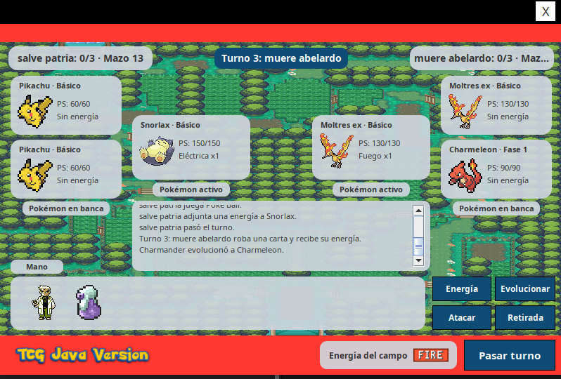

# Pokémon TCG Pocket — Versión Java

Simulación con **interfaz gráfica** del juego de cartas **Pokémon TCG Pocket** (expansión *Genetic Apex*) para **dos jugadores** que comparten el mismo computador y se turnan el mouse. Cada jugador arma su campo, juega cartas, evoluciona y ataca con sus Pokémon, y trata de ser el primero en conseguir **3 puntos de premio**.

Mini Proyecto 2 · Universidad del Valle · Java 21

Este proyecto continúa el [Mini Proyecto 1](https://github.com/Herreron/PokemonTCG-Java-Version), que se jugaba por consola. En esta entrega el juego pasa a ventanas hechas con Java Swing y se agrega la **evolución** de Pokémon.

## Integrantes

- Juan Herrera
- Miguel Marín
- Juan Camilo Bolaños Riascos

## Captura del tablero



## Requisitos

- **Java 21** (JDK). Para comprobarlo, abre una terminal y escribe `java -version`.
- Una terminal. El juego no usa librerías externas: la interfaz está hecha solo con Java Swing.

## Cómo ejecutarlo

1. Descarga o clona el repositorio y abre una terminal **en la carpeta del proyecto** (la que contiene la carpeta `App`).
2. Compila el juego:

   ```
   javac -d out -sourcepath App/src App/src/App.java
   ```

3. Ejecútalo. El comando cambia un poco según tu sistema:

   **Linux y macOS**

   ```
   java -cp out:App/src App
   ```

   **Windows**

   ```
   java -cp "out;App/src" App
   ```

4. En la terminal aparece la pregunta *"Deseas jugar por consola o por interfaz gráfica?"*. Escribe `2` y pulsa **ENTER** para abrir la ventana del juego.

> **Importante:** en el comando de ejecución hay que incluir `App/src` (como aparece arriba), porque ahí están las imágenes, la música y los gritos de los Pokémon. Si solo escribes `java -cp out App`, el juego abre pero sin imágenes ni sonido.

Para salir en cualquier momento usa el botón **X** de la esquina superior derecha de la ventana, o **Salir al escritorio** en el menú principal.

## Cómo se juega

### Objetivo

Ganas el duelo en cuanto ocurre **una** de estas tres cosas:

1. Consigues **3 puntos de premio**.
2. Tu rival **no puede robar carta** al inicio de su turno porque su mazo se quedó vacío.
3. Tu rival **se queda sin Pokémon en juego** (ni activo ni en la banca).

### Antes de empezar

1. En el menú principal pulsa **Partida Rapida**.
2. El **jugador 1** escribe su **nombre**, elige su **mazo** en la lista (Fuego, Agua, Eléctrico o Psíquico) y pulsa **Siguiente**. Luego hace lo mismo el **jugador 2**. Si falta el nombre o el mazo, el juego avisa *"Debe ingresar el nombre y seleccionar un deck."* y no deja avanzar.
3. Pulsa **Lanzar moneda**. La moneda decide quién juega primero; después pulsa **Siguiente**.
4. Se reparten **5 cartas** a cada jugador. Si en esa mano no hay ningún Pokémon básico, la mano vuelve al mazo, se baraja y se reparte otra vez (mulligan automático).
5. **Preparación:** cada jugador, por turnos, elige con botones su **Pokémon activo** y, si quiere, hasta **2 Pokémon básicos para la banca** (pulsa **Terminar** cuando no quiera poner más). Mientras uno se prepara, el otro no debe mirar la pantalla.
6. Aparece la pantalla de **cambio de turno** y empieza el primer jugador.

### El tablero

| Zona | Qué muestra |
|---|---|
| **Arriba a la izquierda y a la derecha** | El nombre de cada jugador, sus **puntos de premio** (x/3) y cuántas cartas le quedan en el **mazo**. |
| **Arriba al centro** | El **número de turno** y el jugador que está jugando. |
| **Casillas de Pokémon** | El jugador 1 juega a la **derecha** y el jugador 2 a la **izquierda**. Cada uno tiene un **Pokémon activo** (al centro) y **2 casillas de banca** (a los lados). Cada casilla muestra el **nombre**, la **etapa** (Básico, Fase 1 o Fase 2), los **PS actuales/máximos** y las **energías** adjuntas. |
| **Registro de eventos** | El cuadro del centro narra todo lo que pasa: ataques, daño con debilidad, evoluciones, Pokémon derrotados, puntos de premio y cartas jugadas. Se puede desplazar para ver lo anterior. |
| **Mano** | Las cartas del jugador en turno. Cada carta es una imagen que se puede tocar. Si pasas el mouse por encima, aparece su nombre. |
| **Botones de acción** | **Energía**, **Evolucionar**, **Atacar** y **Retirada**. |
| **Abajo** | La **energía del campo**: muestra el tipo de energía del turno, o **Usada** si ya la adjuntaste. Al lado está el botón **Pasar turno**. |

Si tocas un Pokémon del tablero sin haber elegido ninguna acción, escucharás su grito.

### Tu turno

Al empezar tu turno, el juego hace dos cosas por ti:

- **Robas 1 carta** de tu mazo.
- **Recibes 1 energía** para adjuntar. Si no la usas en ese turno, se pierde (no se acumula).

Después puedes hacer las acciones en el orden que quieras. Cada una tiene sus límites:

| Acción | Cómo se hace | Límites |
|---|---|---|
| **Adjuntar energía** | Pulsa **Energía** y luego toca uno de tus Pokémon (el activo o uno de la banca). | Solo **1 por turno**. |
| **Jugar una carta de entrenador u objeto** | Toca la carta en tu mano y confirma. Con **Poción**, después toca el Pokémon que quieres curar. Con **Misty**, eliges en una ventana a cuál de tus Pokémon de Agua le das la energía. | Los **objetos** no tienen límite por turno; de las cartas de **soporte** solo puedes jugar **1 por turno**. |
| **Colocar un Pokémon en la banca** | Toca un Pokémon **básico** de tu mano, confirma y luego toca una casilla **vacía** de tu banca. | La banca admite **máximo 2**. Las cartas de evolución no se pueden poner en la banca. |
| **Evolucionar** | Pulsa **Evolucionar** y luego toca el Pokémon que quieres evolucionar. El juego busca en tu mano la carta de evolución que le corresponde. | Ver la sección **Evolución**. |
| **Retirar el Pokémon activo** | Pulsa **Retirada** y elige qué Pokémon de la banca pasa a ser el activo. La ventana muestra el costo. | Debes pagar el **costo de retirada**: se descartan esa cantidad de energías del Pokémon que se retira. |
| **Atacar** | Pulsa **Atacar** y elige uno de los ataques de tu Pokémon activo. Cada ataque muestra su daño y su costo. | Necesitas tener adjuntas **al menos tantas energías como cuesta el ataque** (las energías no se gastan al atacar). Solo puedes atacar **1 vez por turno**, y **el jugador que empieza la partida no puede atacar en su primer turno**. |
| **Pasar turno** | Pulsa **Pasar turno**. | — |

Si intentas algo que no se puede hacer en ese momento, el juego te explica por qué. Por ejemplo: *"Snorlax no tiene la energía necesaria para Golpe Cuerpo"* o *"No puedes evolucionar en tu primer turno"*.

### Cambio de turno

Al pasar el turno, la mano se oculta y aparece el mensaje *"Turno de (nombre). Pásale el computador y presiona Continuar."*. Así un jugador no ve la mano del otro. Al pulsar **Continuar**, el nuevo jugador roba su carta y ve su mano.

### Evolución

Una carta de evolución se coloca sobre un Pokémon en juego (activo o de la banca) cuyo nombre coincida con el de **"Evoluciona de"**. Por ejemplo, Charmeleon se coloca sobre Charmander.

**Reglas:**

- Una **Fase 1** se coloca sobre su Pokémon **básico**, y una **Fase 2** solo sobre su **Fase 1**. No se puede saltar de básico a Fase 2.
- **Nadie puede evolucionar en su primer turno.**
- No se puede evolucionar un Pokémon que **entró en juego en ese mismo turno**.
- Cada Pokémon puede evolucionar **solo una vez por turno**: de básico a Fase 2 toma al menos dos turnos.
- Sí puedes evolucionar **varios Pokémon distintos** en el mismo turno, y puedes **atacar después de evolucionar**.

**Qué pasa al evolucionar:**

- El Pokémon **conserva sus energías y el daño** que tenía. Sus PS máximos pasan a ser los de la evolución. Por ejemplo, un Charmander con 20/60 PS (40 de daño) evoluciona a Charmeleon y queda con 50/90 PS.
- El tipo, los ataques y el costo de retirada pasan a ser los de la evolución.
- Las cartas de evolución **no cuentan como Pokémon básicos**: no evitan el mulligan, no se pueden poner en la banca desde la mano y la Poké Ball no las busca.

### Combate

- El daño del ataque se aplica al **Pokémon activo del rival**.
- **Debilidad:** si el tipo del *ataque* es al que el Pokémon defensor es débil, el ataque hace **+20 de daño**. En esta versión, los Pokémon de **Fuego** son débiles a los ataques de **Agua**, y los Pokémon de **Agua** son débiles a los ataques **Eléctricos**. (Cuenta el tipo del ataque, no el del Pokémon que ataca: por ejemplo, Picotazo de Zapdos ex es un ataque Incoloro.)
- Cuando un Pokémon se queda **sin PS**, sale del campo junto con sus evoluciones y sus energías, y quien lo derrotó gana **1 punto de premio** (o **2 puntos** si era un Pokémon **ex**).
- El dueño del Pokémon derrotado **elige en una ventana a otro Pokémon de su banca** como nuevo activo. Si no le queda ninguno, pierde el duelo.

### Fin de la partida

Cuando alguien gana, aparece un mensaje que anuncia al campeón y **cómo ganó** (por puntos de premio, porque el rival se quedó sin Pokémon o porque el rival no pudo robar carta). En ese mismo mensaje puedes elegir:

- **Nueva partida:** vuelve a la pantalla del jugador 1 para empezar otro duelo.
- **Salir:** cierra el juego.

### Cartas de entrenador

| Carta | Tipo | Efecto |
|---|---|---|
| Investigacion del Profesor | Soporte | Descartas toda tu mano y robas 2 cartas del mazo. |
| Misty | Soporte | Adjuntas 3 energías a uno de tus Pokémon de tipo Agua que esté en juego. |
| Pocion | Objeto | Curas 20 PS a uno de tus Pokémon heridos en juego. |
| Poke Ball | Objeto | Buscas en tu mazo 1 Pokémon básico y lo pones en tu mano. |
| Turbo Velocidad | Objeto | Durante este turno, el costo de retirada de tu Pokémon activo baja en 1. |

### Mazos

Cada mazo tiene exactamente **20 cartas**: 2 copias de cada una de las 10 cartas distintas que lo forman, y siempre incluye al menos 6 Pokémon básicos.

| Mazo | Pokémon | Entrenador |
|---|---|---|
| 🔥 Fuego | Charmander, Charmeleon, Charizard, Moltres ex, Growlithe, Arcanine | Pocion, Poke Ball, Turbo Velocidad, Investigacion del Profesor |
| 💧 Agua | Squirtle, Wartortle, Blastoise, Magikarp, Gyarados, Articuno ex, Psyduck, Golduck | Poke Ball, Misty |
| ⚡ Eléctrico | Pikachu, Raichu, Zapdos ex, Electabuzz, Jigglypuff, Wigglytuff, Snorlax | Pocion, Poke Ball, Investigacion del Profesor |
| 🔮 Psíquico | Mewtwo ex, Gastly, Haunter, Gengar, Jigglypuff, Wigglytuff, Snorlax | Pocion, Turbo Velocidad, Investigacion del Profesor |

### Pokémon disponibles

La columna **Etapa** es la que muestra el juego: **Básico** es el único que puedes colocar al empezar o en la banca; **Fase 1** y **Fase 2** son evoluciones. Los Pokémon **ex** valen 2 puntos de premio al ser derrotados. Los nombres de cartas y ataques aparecen en el juego sin tildes.

| Pokémon | Tipo | Etapa | PS | Retirada | Ataques: nombre (energías) → daño | Evoluciona de |
|---|---|---|---|---|---|---|
| Charmander | 🔥 Fuego | Básico | 60 | 1 | Ascuas (1) → 30 | — |
| Charmeleon | 🔥 Fuego | Fase 1 | 90 | 2 | Garras de Fuego (3) → 60 | Charmander |
| Charizard | 🔥 Fuego | Fase 2 | 150 | 2 | Giro Fuego (4) → 150 | Charmeleon |
| Moltres ex | 🔥 Fuego | Básico | 130 | 2 | Aleteo (1) → 30<br>Danza Infernal (3) → 70 | — |
| Growlithe | 🔥 Fuego | Básico | 70 | 1 | Mordisco (1) → 10 | — |
| Arcanine | 🔥 Fuego | Fase 1 | 130 | 2 | Lanzallamas (3) → 90 | Growlithe |
| Squirtle | 💧 Agua | Básico | 60 | 1 | Placaje (1) → 20 | — |
| Wartortle | 💧 Agua | Fase 1 | 80 | 1 | Salpicadura (2) → 40 | Squirtle |
| Blastoise | 💧 Agua | Fase 2 | 150 | 3 | Hidrobomba (3) → 80 | Wartortle |
| Magikarp | 💧 Agua | Básico | 30 | 1 | Chapoteo (1) → 10 | — |
| Gyarados | 💧 Agua | Fase 1 | 150 | 4 | Hiperrayo (4) → 100 | Magikarp |
| Articuno ex | 💧 Agua | Básico | 130 | 2 | Viento Helado (1) → 30<br>Ventisca (3) → 100 | — |
| Psyduck | 💧 Agua | Básico | 60 | 1 | Dolor de Cabeza (1) → 20 | — |
| Golduck | 💧 Agua | Fase 1 | 90 | 1 | Rayo Aurora (2) → 60 | Psyduck |
| Pikachu | ⚡ Eléctrico | Básico | 60 | 1 | Mordisco (1) → 20 | — |
| Raichu | ⚡ Eléctrico | Fase 1 | 100 | 1 | Rayo (3) → 140 | Pikachu |
| Zapdos ex | ⚡ Eléctrico | Básico | 130 | 2 | Picotazo (1) → 30<br>Tormenta Electrica (3) → 100 | — |
| Electabuzz | ⚡ Eléctrico | Básico | 80 | 1 | Puño Trueno (2) → 40 | — |
| Mewtwo ex | 🔮 Psíquico | Básico | 150 | 2 | Ataque Psiquico (2) → 50<br>Psicorrayo (3) → 150 | — |
| Gastly | 🔮 Psíquico | Básico | 50 | 1 | Lengüetazo (1) → 10 | — |
| Haunter | 🔮 Psíquico | Fase 1 | 70 | 1 | Tinieblas (2) → 40 | Gastly |
| Gengar | 🔮 Psíquico | Fase 2 | 130 | 2 | Bola Sombra (3) → 80 | Haunter |
| Jigglypuff | ⭐ Incoloro | Básico | 70 | 1 | Golpe (1) → 20 | — |
| Wigglytuff | ⭐ Incoloro | Fase 1 | 100 | 1 | Vozarron (2) → 60 | Jigglypuff |
| Snorlax | ⭐ Incoloro | Básico | 150 | 3 | Golpe Cuerpo (3) → 100 | — |

### Consejos para tu primera partida

- Adjunta tu energía **todos los turnos**, aunque no vayas a atacar todavía: si no la usas, se pierde.
- Mira el costo de cada ataque antes de decidir en qué Pokémon adjuntas la energía.
- Procura tener siempre al menos **un Pokémon en la banca**: si tu activo es derrotado y no te queda ninguno, pierdes el duelo.
- Guarda tus cartas de evolución para el turno siguiente a bajar el Pokémon básico: no se puede evolucionar el mismo turno en que entra en juego.
- Cuando aparezca la pantalla de **cambio de turno**, el otro jugador no debe mirar: después de pulsar **Continuar** se muestra la mano del jugador en turno.
